# **📸 InstaSphere – Kubernetes-Based Social Media Platform**

- Containerized Web Application Deployment using Kubernetes

## **📖 About The Project**
This project demonstrates the deployment of a containerized 3-tier web application on Kubernetes.

The application provides an Instagram-style user interface with user registration, login, authentication, and dashboard functionality.

The application is divided into separate frontend, backend, and database tiers. Kubernetes is used to manage application containers, networking, persistent storage, configuration, secrets, and service communication.

## **🏗️ Architecture Diagram**

<p align="center">
  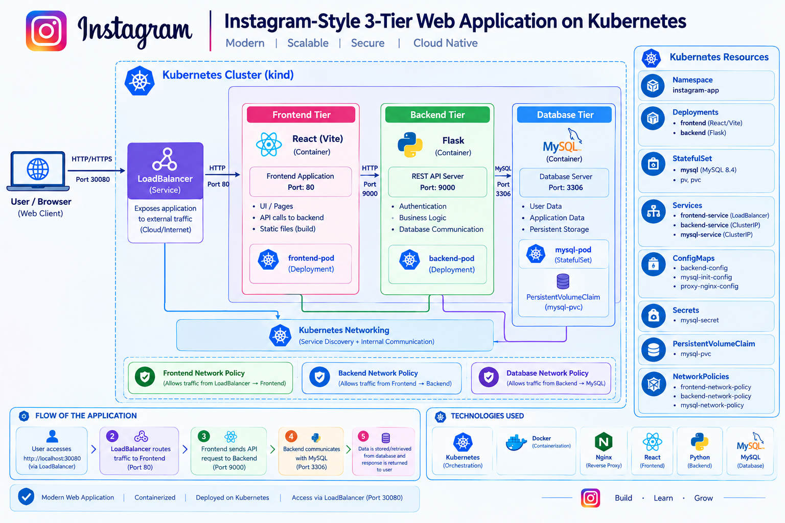
</p>

## **⚙️ Tech Stack**
- Kubernetes
- Docker
- React + Vite
- Nginx
- Python
- Flask
- MySQL 8.4
- Kubernetes LoadBalancer
- ConfigMaps
- Secrets
- PersistentVolumeClaim
- NetworkPolicies
- Kustomize
- YAML

## **⚡ Project Workflow**

```text
💻 Application Development
        ↓
🐳 Docker Containerization
        ↓
📦 Build Frontend & Backend Images
        ↓
☁️ Push Images to Docker Hub
        ↓
☸️ Configure Kubernetes Resources
        ↓
⚙️ Deploy Using Kustomize
        ↓
🔍 Verify Kubernetes Resources
        ↓
🔄 Switch NodePort → LoadBalancer
        ↓
🌐 Access Application via LoadBalancer
        ↓
🔐 Register & Login
        ↓
✨ Instagram-Style Dashboard

```

### **🐳 Step 1 — Building the Application Containers**

First, the frontend and backend applications were containerized using Docker.
#### **Frontend**
- React + Vite application
- Nginx used to serve the frontend
- Dockerfile created for production build
#### **Backend**
- Python Flask REST API
- Dockerfile created for backend
- API handles authentication and database communication
#### **Database**
- MySQL 8.4 configured for application data

Built Docker images for application components  


<p align="center">
  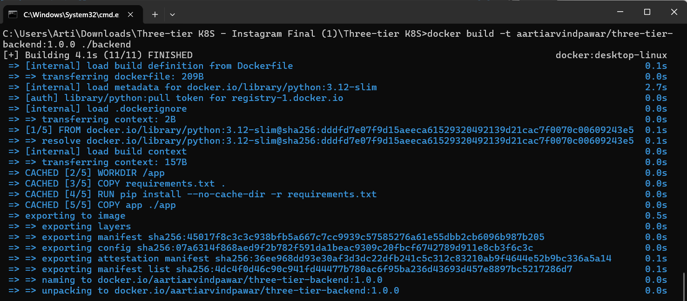
</p>

<p align="center">
  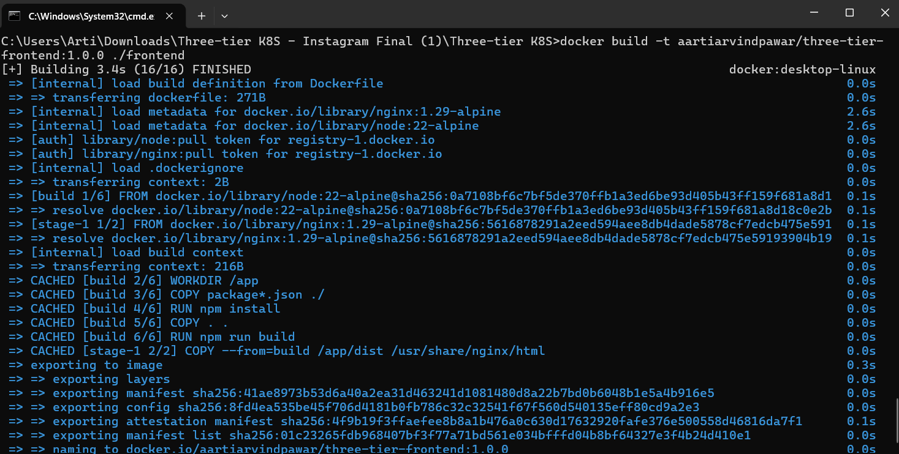
</p>

<p align="center">
  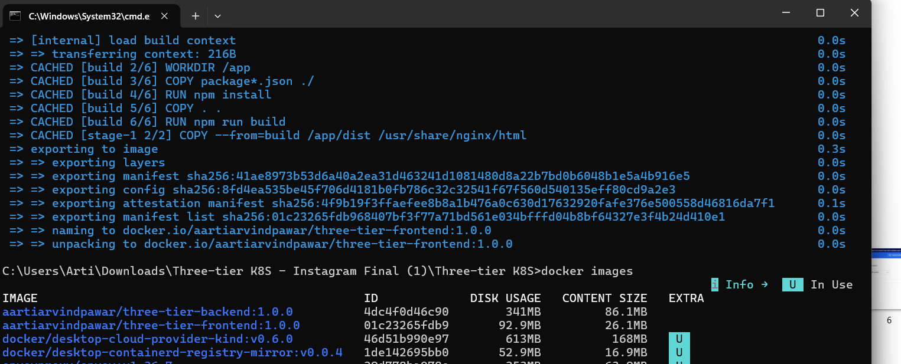
</p>

The Docker images were then built successfully for both frontend and backend.  

### **🔹 Step 2 : Push Docker Images**
- Tagged Docker images
- Pushed frontend image to Docker Hub
- Pushed backend image to Docker Hub  
- Frontend Image:
   - aartiarvindpawar/three-tier-frontend:1.0.0
- Backend Image:
   - aartiarvindpawar/three-tier-backend:1.0.0

<p align="center">
  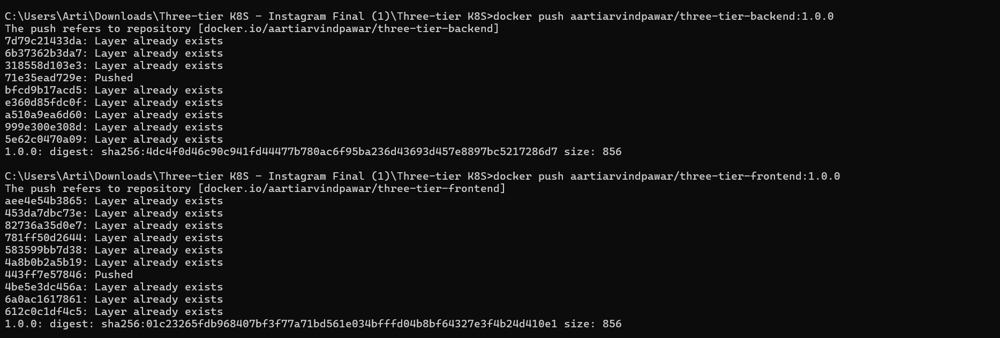
</p>

<p align="center">
  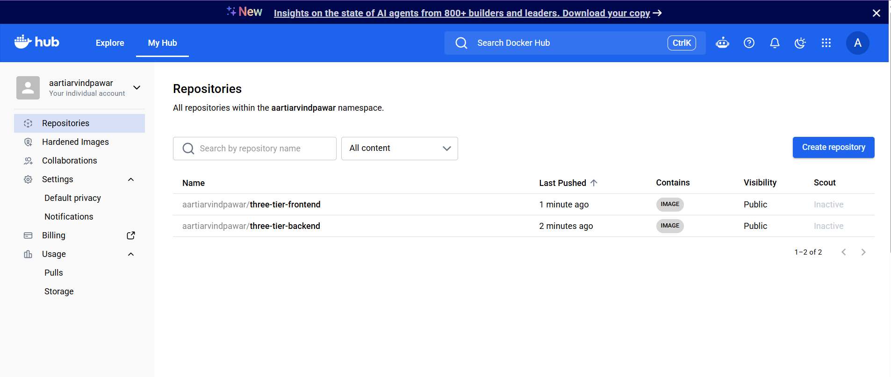
</p>

<p align="center">
  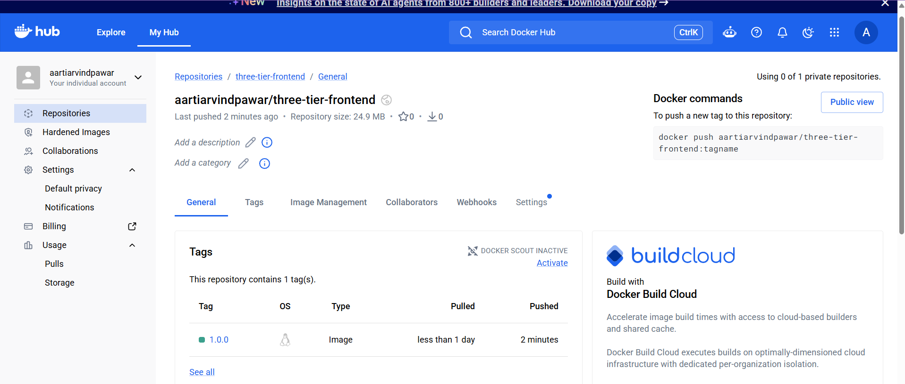
</p>

<p align="center">
  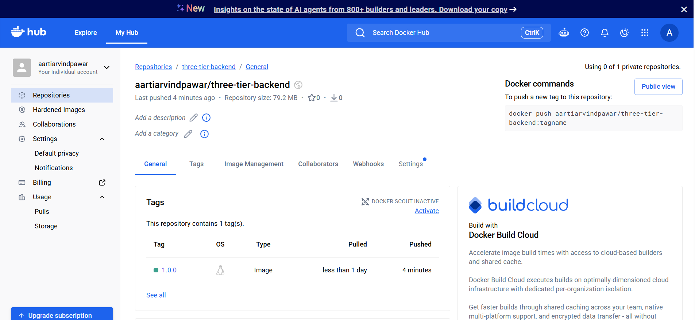
</p>

### **☸️ Step 3 — Kubernetes Configuration with Kustomize**

The Kubernetes resources were organized using Kustomize.
The configuration contains resources for:
- Namespace
- Secrets
- ConfigMaps
- MySQL
- Backend
- Frontend
- Proxy
- Ingress
- NetworkPolicies
- Persistent storage

The project also uses Kustomize to manage image names and versions from a central configuration.

<p align="center">
  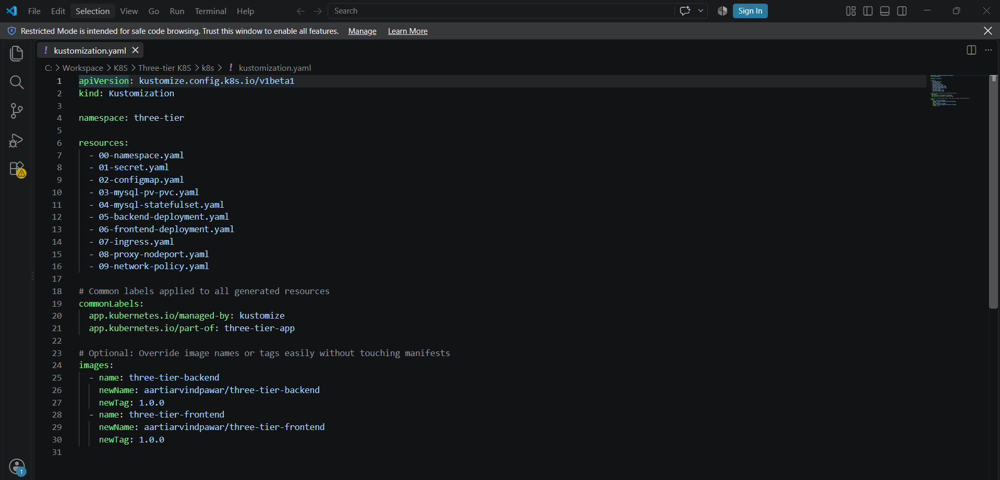
</p>

### **🚀 Step 4 — Deploying the Application on Kubernetes**

After preparing the Kubernetes manifests, all resources were deployed using Kustomize.

<p align="center">
  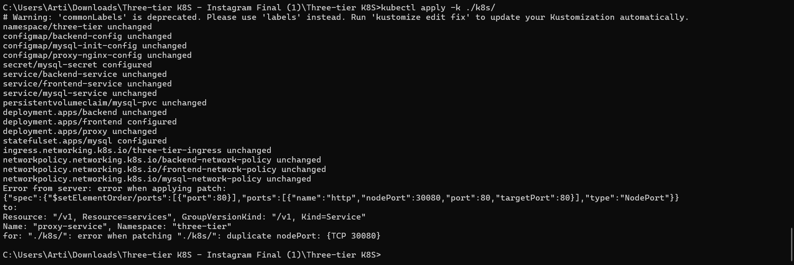
</p>


### **🔄 Step 5 — Switching from NodePort to LoadBalancer**
🔧 From NodePort → LoadBalancer
Initially, the application was exposed using NodePort during the earlier setup.
For the final implementation, the frontend service was changed to:

- type: LoadBalancer

This change makes the application externally accessible through the Kubernetes LoadBalancer Service instead of relying on NodePort access.

Before

- type: NodePort

Final Configuration

- type: LoadBalancer

After changing the Service configuration, the Kubernetes resources were applied again:

- kubectl apply -k ./k8s/

Then the Service status was verified:

kubectl get svc -n three-tier

<p align="center">
  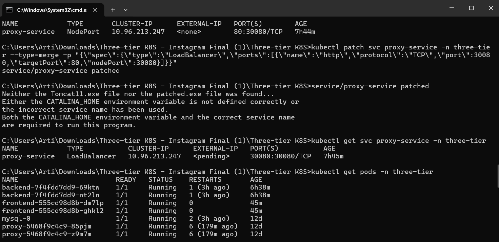
</p>

### **🔍 Step 6 — Verifying Kubernetes Resources**
Once deployment was completed, all Pods, Services, Deployments and StatefulSets were checked.

- kubectl get all -n three-tier

The verification screenshot shows the application components running, including:

- Backend Pods
- Frontend Pods
- Proxy Pods
- MySQL StatefulSet
- Kubernetes Services
- Deployments
- ReplicaSets

<p align="center">
  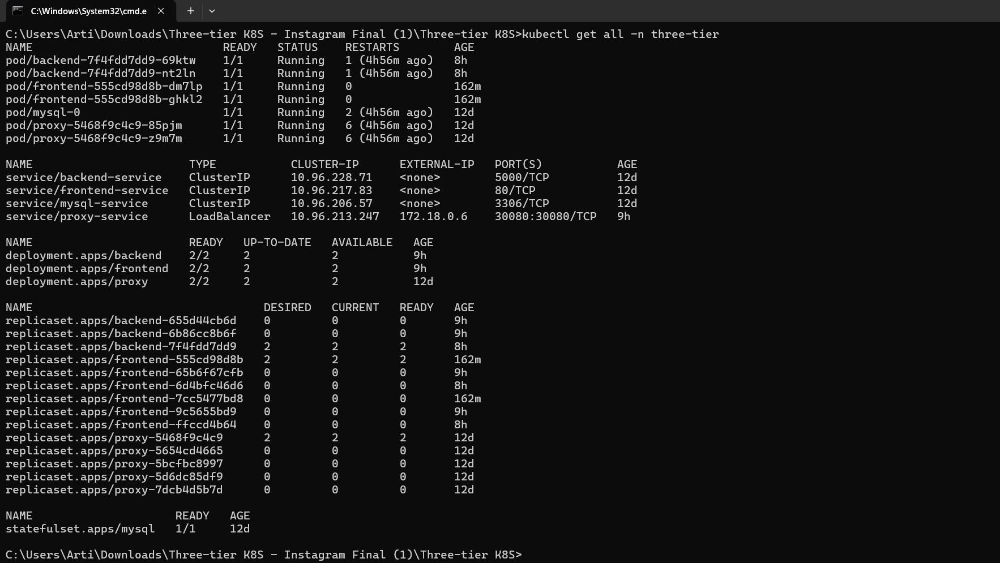
</p>


### **🌐 Step 7 — Accessing the Application**
After confirming that the Kubernetes resources were running, the application was accessed through the configured LoadBalancer.

🌍 Application URL

- http://localhost:30080

<p align="center">
  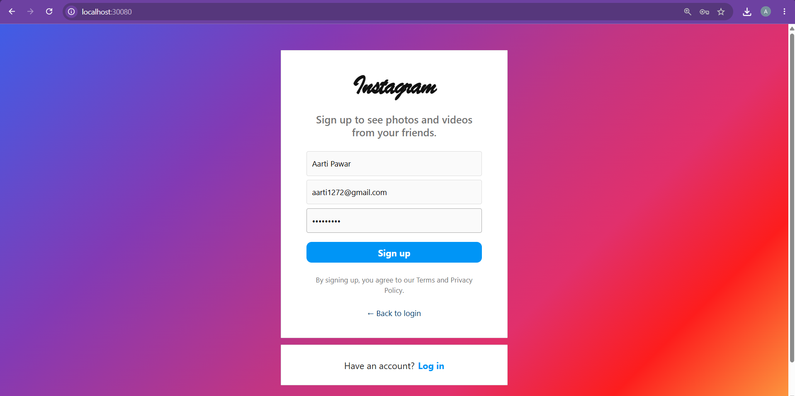
</p>

<p align="center">
  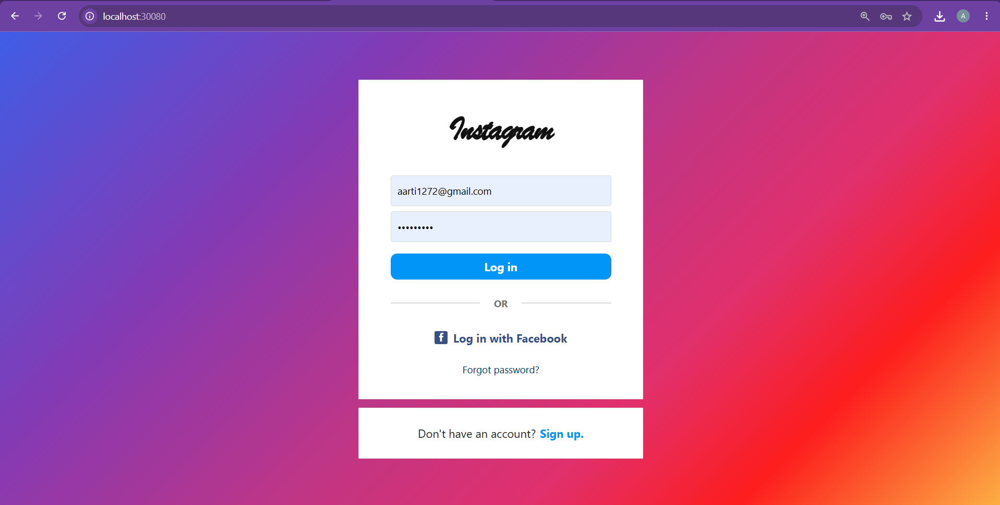
</p>

<p align="center">
  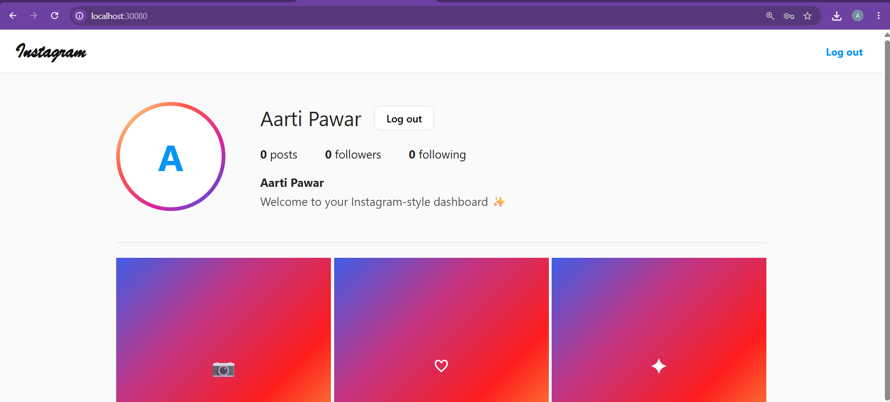
</p>

## **🏆 Key Highlights**
- ✨ Instagram-style user interface
- 🐳 Containerized frontend and backend
- ☸️ Kubernetes-based deployment
- 🔄 NodePort → LoadBalancer migration
- 🌐 External application access through LoadBalancer
- 🔐 Authentication and secure configuration
- 🛡️ NetworkPolicies for controlled communication
- 💾 Persistent MySQL storage
- 📦 Docker Hub image management
- ⚙️ Kustomize-based deployment

## **💡 What I Learned**
Through this project, I gained practical experience in:

- Building Docker images
- Publishing images to Docker Hub
- Deploying applications on Kubernetes
- Working with Deployments and StatefulSets
- Creating Kubernetes Services
- Switching service exposure from NodePort to LoadBalancer
- Configuring persistent storage
- Using ConfigMaps and Secrets
- Implementing NetworkPolicies
- Managing Kubernetes resources using Kustomize
- Verifying application health using kubectl
- Connecting frontend, backend and database components

## **🎯 Project Outcome**
- Successfully deployed an Instagram-style web application on Kubernetes.
- Implemented a containerized 3-tier architecture.
- Configured Kubernetes networking and service discovery.
- Implemented persistent database storage using PVC.
- Secured sensitive configuration using Kubernetes Secrets.
- Controlled inter-tier communication using NetworkPolicies.
- Successfully tested user registration and login functionality.